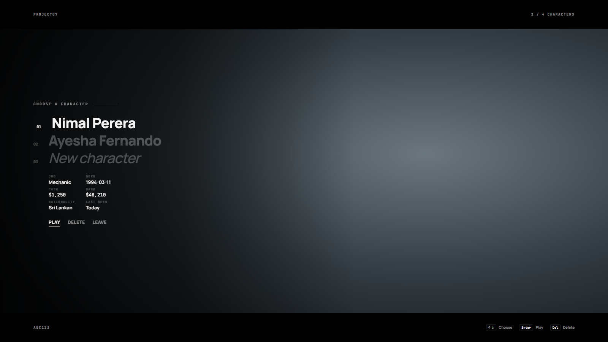

# Project07_FreeMultichar

Free multicharacter screen for Qbox. One cinematic scene: letterbox bars, your character on the right, a clean text list on the left. No admin panel, everything is in `config.lua`.

## Features
- `Config.maxSlots` characters per account (admins can give more, up to `Config.slotLimit`), ↑ ↓ to pick, Enter to play, Del to delete (press twice).
- Your saved look (illenium-appearance) on the character in the scene; a default look with a face for characters without one.
- Create a character: first / last name, birth date, nationality, male / female (the body changes while you choose).
- Starter items for new characters, then the spawn selector (or a fixed spot), then the clothing menu.
- Discord logs: created, played, deleted, and blocked attempts to load someone else's character.
- Every request is checked on the server (ownership, slot limit, name rules, rate limits).

## Commands
| Command | Who | What |
|---|---|---|
| `/logout` | players (`Config.playerLogout`) | back to the character screen |
| `/logout <id>` | admins | sends that player back to the character screen |
| `/addcharslot <id> [amount]` | admins | more character slots for that player's account (saved in `p07free_slots`) |
| `/removecharslot <id> [amount]` | admins | fewer slots |

Admin = `group.admin` (or the framework's admin check). Command names are in `Config.commands`.

## Requirements
- [qbx_core](https://github.com/Qbox-project/qbx_core)
- [ox_lib](https://github.com/overextended/ox_lib)
- [oxmysql](https://github.com/overextended/oxmysql)
- [Project7H_Lib](https://github.com/PehesaraNimnad/Project7H_Lib/releases/latest) (framework / appearance / weather / spawn layer)
- illenium-appearance or fivem-appearance (character looks)
- Optional: Project07_FreeSpawn, Project07_FreeLoadscreen

## Installation
1. Put `Project07_FreeMultichar` in your `resources` folder.
2. In `qbx_core/config/client.lua` set `characters.useExternalCharacters = true` (turns off the built-in screen).
3. Add to `server.cfg` after the requirements:
   ```
   ensure Project7H_Lib
   ensure Project07_FreeMultichar
   ```
4. Optional: put a Discord webhook in `sv_config.lua`.
5. Change the scene, slots, starter items and name rules in `config.lua`.

Do not run it together with another multicharacter script.

## Building the UI (only if you change it)
The built UI is in `web/build`. Sources are in `web/src` (React + TypeScript + Vite):
```
cd web
npm install
npx vite build --mode multichar
```
Copy `build/multichar` to `web/build`.

## Preview


